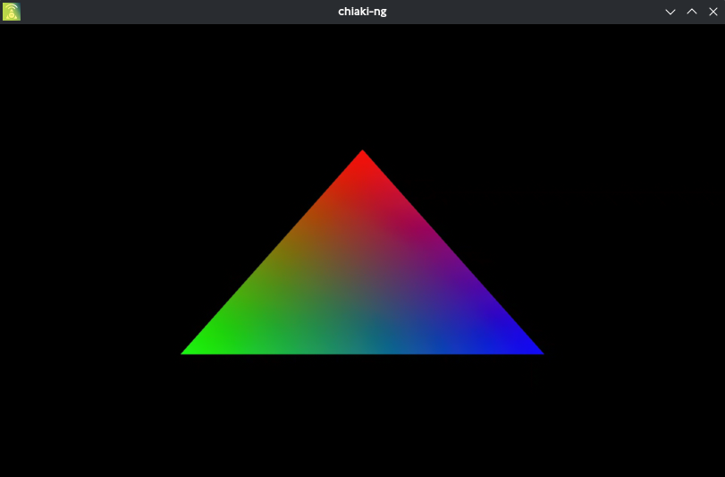
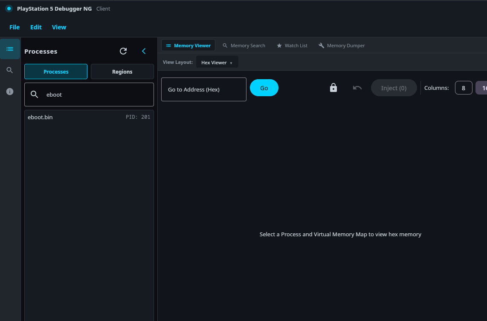
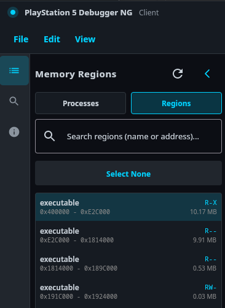

# ps5-app-sdk
A minimal template for building a native app with OpenGL support to run from the PS5's home screen. Currently supports the meson build system, with plans to add support for other build systems. Based on the work of [BlackBearReloaded](https://github.com/blackbearreloaded/ps5-native-app-boilerplate) and the [PS5 Payload SDK](https://github.com/ps5-payload-dev/sdk), cleaned up significantly to make it easier to understand, maintain, and develop apps.



## Requirements
 * Jailbroken PS5
 * Any linux system with Docker

## Usage
Use the ./drun.sh script to interface with the dev container. On the first run of the script, the image will be built locally.
 * ./drun.sh {command}
 * ./drun.sh --interactive

### Setup
1. ./drun.sh ./scripts/download_dependencies.sh
2. ./drun.sh ./setup_build_meson.sh
3. ./drun.sh meson compile -C build
4. Copy PPSA99999 folder from build/ to your PS5 /data/homebrew
5. Run ShadowMount+
6. Launch app from the PS5 homescreen

### Customization
* Change the serial of your app by editing app_serial in meson.build, don't forget to also edit param.json in sce_sys
* Replace the pic0, pic1, and icon0.png with any images
* Replace snd0.at9 with music encoded with ATRAC9


## Debugging With GDB

Using the ps5debug-ng and gdbsrv payloads, it is possible to debug PS5 applications. Follow these steps:

1. A build of gdb with freebsd support is required. On linux, the following config can be used to build gdb:

configure.prospero
```bash
#!/bin/bash
./configure --enable-targets=x86_64-redhat-linux-gnu,x86_64-unknown-freebsd \
             --with-auto-load-dir=$debugdir:$datadir/auto-load \
             --with-auto-load-safe-path=$debugdir:$datadir/auto-load \
             --with-expat \
             --with-gdb-datadir=/usr/share/gdb \
             --with-jit-reader-dir=/usr/lib64/gdb \
             --without-libunwind-ia64 \
             --with-lzma \
             --with-babeltrace \
             --with-intel-pt \
             --with-xxhash \
             --with-python=/usr \
             --with-python-libdir=/usr/lib \
             --with-curses \
             --without-guile \
             --without-amd-dbgapi \
             --enable-source-highlight \
             --enable-threading \
             --enable-tui \
             --with-system-readline
```
2. Jailbreak the PS5
3. Run the gdbsrv and ps5debug-NG payloads
4. Open [PS5Debug-NG gui](https://github.com/boazvdwansem/ps5-debugger)
5. Type eboot in the search bar 
6. Make a note of the eboot process ID
7. Click the eboot process. There will be a bunch of regions. Typically the first large executable region is the .text section. 
8. The start address of this section is the ELF symbol offset for GDB. Make a note of this offset.
9. Launch GDB and run the following:
```
target extended-remote {your-ps5-ip-address}:2159
attach {pid}
add-symbol-file build/eboot.elf {offset-obtained-from-ps5debug}
```

### .gdbinit file
A .gdbinit file can be used to automate the process of conntecing to the PS5 and loading symbols.

Example .gdbinit file:
```
target extended-remote {your-ps5-ip-adress}:2159
add-symbol-file build/eboot.elf {offset-obtained-from-ps5debug}
```